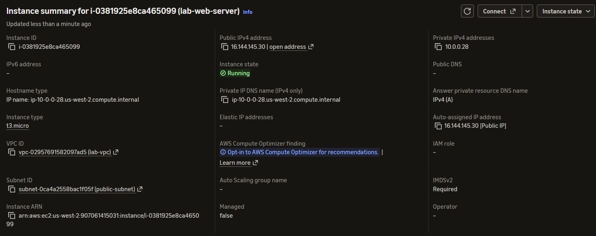
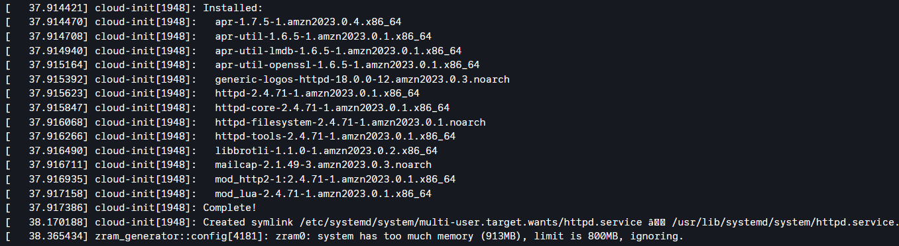
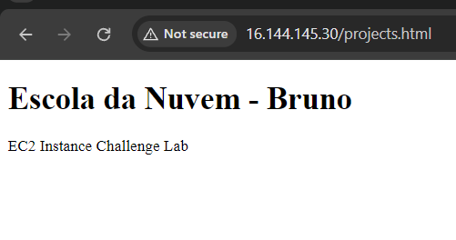

# Lab 9 - Lab 172 - Amazon EC2 Instances (Challenge)

## Visão geral

Laboratório de desafio da Escola da Nuvem com foco na configuração de uma rede virtual na AWS e na implantação de uma aplicação web em uma instância Amazon EC2 com Amazon Linux.

## Objetivos

- Criar e configurar uma VPC e uma subnet pública.
- Configurar Internet Gateway e tabela de rotas.
- Criar um Security Group para acesso SSH e HTTP.
- Provisionar uma instância Amazon EC2.
- Utilizar User Data para instalar e iniciar o servidor web Apache (`httpd`).
- Publicar e acessar uma página web hospedada na instância.

## Arquitetura implementada

| Recurso | Configuração |
|---|---|
| VPC | `lab-vpc` |
| CIDR da VPC | `10.0.0.0/16` |
| Subnet | `public-subnet` |
| CIDR da subnet | `10.0.0.0/24` |
| Internet Gateway | `lab-igw` |
| Route Table | `public-route-table` |
| Security Group | `sg_web_access` |
| Instância EC2 | `lab-web-server` |
| Servidor web | Apache HTTP Server (`httpd`) |

## Implementação

A infraestrutura foi configurada pelo AWS Management Console, incluindo a criação da rede virtual, subnet pública, gateway de internet, tabela de rotas e regras de acesso.

A instância EC2 foi provisionada com Amazon Linux e configuração de User Data para instalar, iniciar e habilitar o serviço Apache.

O acesso à instância foi realizado pelo EC2 Instance Connect. A aplicação foi publicada no diretório `/var/www/html`, permitindo sua visualização pelo endereço IPv4 público da instância.

## Evidências

### 1. Resumo da instância EC2

### 2. System Log - instalação do Apache

### 3. Aplicação web em execução

## Página do projeto

[**Acessar GitHub Pages**](https://brunogacarvalho.github.io/amazon-ec2-instances-challenge/)

A página apresenta um resumo do laboratório e, ao final, disponibiliza 8 flashcards interativos para revisar os principais conceitos de Amazon EC2, VPC, subnet, Security Group e Apache.

## Créditos

Laboratório realizado durante a formação em Computação em Nuvem (AWS re/Start) da **Escola da Nuvem**.

- Professor: [Raphael Ohlsen](https://linkedin.com/)
- Instituição: [Escola da Nuvem](https://escoladanuvem.org/) | [LinkedIn da Escola da Nuvem](https://linkedin.com/)

Laboratório realizado como parte da formação em Computação em Nuvem AWS.

---

*Documentação desenvolvida para registrar a prática e os recursos utilizados no laboratório.*
